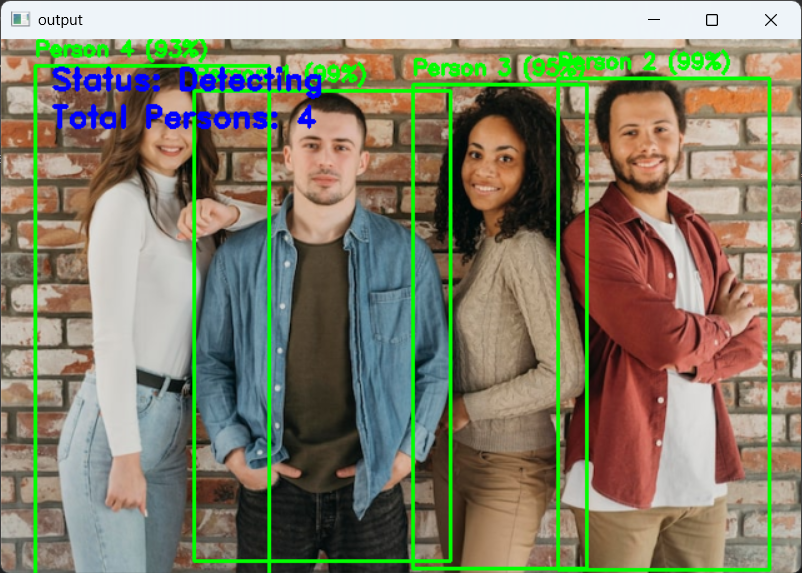
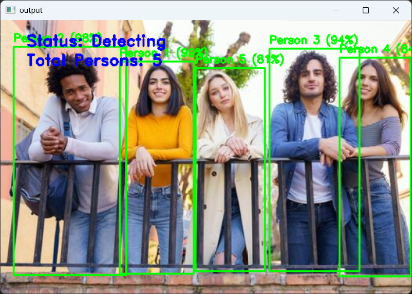

# Vision Crowd Detector

A real-time human detection system built with Python and OpenCV, using full YOLOv4 for accurate person detection in images, pre-recorded videos, and live webcam streams. Features automatic GPU acceleration, Soft-NMS for crowded scenes, and confidence score display.

---

## Features

- Real-time person detection in images, videos, and webcam feeds
- Full YOLOv4 model for high accuracy, especially in crowded/overlapping scenes
- Confidence score displayed on each bounding box
- Real-time person count displayed on screen
- Soft-NMS — preserves detections of people standing close together
- Auto GPU detection — uses NVIDIA CUDA if available, falls back to CPU silently
- Webcam camera index fallback (tries index 0, then 1 automatically)
- Video playback synced to correct FPS
- Optional output saving for images and videos 

---

##  Output Samples

<p align="center">
  
  
</p>

<p align="center">
  <em>YOLOv4 + Soft-NMS detection results on crowd scenes</em>
</p>

---

## Requirements

- Python 3.10 (64-bit)
- OpenCV with CUDA support
- imutils
- NumPy

Install dependencies:
```bash
pip install imutils
pip install "numpy<2.0"
pip install nvidia-cudnn-cu12==8.9.7.29
```

---

## Model Files (Required)

Download these three files and place them in the **same folder** as the script:

| File | Download |
|------|----------|
| `yolov4.weights` | [Download](https://github.com/AlexeyAB/darknet/releases/download/darknet_yolo_v4_pre/yolov4.weights) |
| `yolov4.cfg` | [Download](https://raw.githubusercontent.com/AlexeyAB/darknet/master/cfg/yolov4.cfg) |
| `coco.names` | [Download](https://raw.githubusercontent.com/AlexeyAB/darknet/master/data/coco.names) |

Or use curl:
```bash
curl -L "https://github.com/AlexeyAB/darknet/releases/download/darknet_yolo_v4_pre/yolov4.weights" -o models/yolov4.weights
curl -L "https://raw.githubusercontent.com/AlexeyAB/darknet/master/cfg/yolov4.cfg" -o models/yolov4.cfg
curl -L "https://raw.githubusercontent.com/AlexeyAB/darknet/master/data/coco.names" -o models/coco.names
```
---

## Usage
 
### Webcam (live detection)
```bash
python python_pp.py -c
```

### Video file
```bash
python python_pp.py -v "path\to\video.mp4"
```

### Image file
```bash
python python_pp.py -i "path\to\image.jpg"
```

### Save output to file
Add `-o` with an output path to any of the above commands:
```bash
python python_pp.py -v "path\to\video.mp4" -o "path\to\output.avi"
python python_pp.py -i "path\to\image.jpg" -o "path\to\output.jpg"
```

### All arguments

| Argument | Description |
|----------|-------------|
| `-c` | Use webcam for live detection |
| `-v VIDEO` | Path to a video file |
| `-i IMAGE` | Path to an image file |
| `-o OUTPUT` | Path to save the output file (optional) |

Press **Q** to quit during video or webcam detection.

---

## Project Structure

```
vision-crowd-detector/
│
├── images/                 # Test images
├── videos/                 # Test videos
├── models/                 # YOLOv4 model files (download separately)
│   ├── yolov4.weights
│   ├── yolov4.cfg
│   └── coco.names
├── libs/                   # cuDNN DLLs (not tracked by git)
├── python_pp.py            # Main script
├── .gitignore
└── README.md         
```

---

## How It Works

1. Each frame is passed through full YOLOv4, a deep convolutional neural network trained on the COCO dataset (80 classes).
2. Only detections with class label person and confidence above 0.25 are kept.
3. Soft-NMS is applied — overlapping boxes have their scores decayed rather than deleted outright, preserving detections of people in crowds.
4. Bounding boxes with confidence percentages are drawn on the frame and displayed in real time.

---

## GPU Acceleration
 
Detection automatically uses an NVIDIA CUDA GPU if available, and falls back to CPU otherwise — no code changes needed.
 
| Mode | Expected FPS |
|------|-------------|
| NVIDIA GPU (CUDA) | 15–30 FPS |
| CPU only | 1–3 FPS |
 
**Requirements for GPU mode:**
- NVIDIA GPU (Maxwell-class / GTX 900-series or newer)
- CUDA Toolkit 12.x
- cuDNN 8.x DLLs in `libs/` folder
---

## Tuning Detection

Two parameters in the `detect()` function can be adjusted:

| Parameter | Default | Effect |
|-----------|---------|--------|
| `conf_threshold` | `0.3` | Lower = detects more people but may add false positives |
| `nms_threshold` | `0.3` | Lower = stricter duplicate removal; raise if overlapping people are missed |

For crowded scenes with overlapping people, the script uses **Soft-NMS**, which decays confidence scores of overlapping boxes rather than deleting them outright — this preserves detections of people standing close together.

---

## Known Limitations

- Full YOLOv4 is slow on CPU (1–3 FPS) — a CUDA-capable GPU is strongly recommended.
- Heavily occluded people (>70% hidden) may still be missed.
- Very small or distant people may not be detected reliably at `608` blob size.
---

## License

This project uses the YOLOv4 model by [AlexeyAB](https://github.com/AlexeyAB/darknet), which is licensed under the MIT License.
